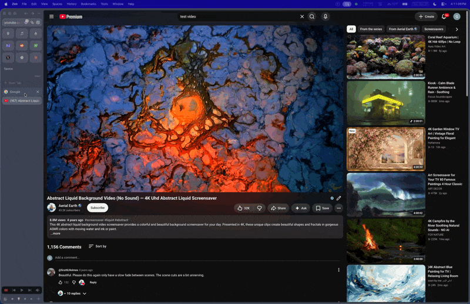

# ArcSlide Mini Player (PiP) for Zen

**Arc's mini player, back, in [Zen Browser](https://zen-browser.app).** Switch tabs and your video pops out. Fling it and it slides into a corner. Arc's hover controls come with it.

<!-- Demo: record a short clip of a throw + the controls and save it as docs/media/demo.gif, then uncomment:

-->

If you moved from Arc to Zen and miss the little floating video you could toss into any corner, this brings it back.

## What you get

**Pop out**
- Switch tabs and the playing video pops out into a floating mini player. Go back to the tab and it pops back in.
- Works for *any* playing video, not just Firefox's picks (45 s+, with sound): muted videos, short clips, reels, and sites like Instagram that pause the video the moment you leave the tab.

**Slide**
- Click-drag the mini player and let go with some speed. It carries your momentum, hits the screen edge and slides into the corner, like Arc.
- On a trackpad or Magic Mouse, hover it and drag with two fingers. It follows your fingers 1:1, and a flick throws it.
- Drag, pause, release: it stays exactly where you put it.
- Each throw lands on the screen the mini player is on. Want it on another monitor? Drag it there, then throw.

**Arc's controls**
- Back to Tab, Minimize and Close pills; play/pause; ±15 s skips on larger windows.
- A timeline you can click or drag. Drag upward while scrubbing for finer seeking.
- A sound on/off button, kept in sync with Zen's sidebar media controls.
- Right-click the video for Mute and Copy URL.
- Controls fade in on hover and hide after 3 s, like Arc.

## Install

Needs **Zen on macOS**.

**Option 1: one line in Terminal**

```sh
curl -fsSL https://raw.githubusercontent.com/ashworthiv/arcslide-miniplayer-pip-for-zen/main/install.sh | bash
```

**Option 2: download**

1. Download `ArcSlide.zip` from the [latest release](https://github.com/ashworthiv/arcslide-miniplayer-pip-for-zen/releases/latest) and unzip it.
2. Double-click `Install.command`. If macOS blocks it, open **System Settings → Privacy & Security**, scroll down and click **Open Anyway**.

The installer asks a couple of questions; pressing Return keeps the defaults. Zen quits and reopens by itself, and your tabs come back.

> **After every Zen update, run the installer again.** Zen updates replace the loader files inside Zen.app. Running it over an existing install is fine; it updates in place.

**Uninstall:** run `Uninstall.command` from the zip.

## Settings

Nothing to set up; the defaults match Arc. To fine-tune, open `about:config` and search `zen.pipthrow`:

| Pref | Default | What it does |
|---|---|---|
| `zen.pipthrow.enabled` | true | master switch for sliding |
| `zen.pipthrow.minVelocity` | 120 | release speed (pt/s) that counts as a throw; slower and it stays put |
| `zen.pipthrow.maxThrowVelocity` | 1500 | cap on throw speed, so mouse and trackpad throws feel alike (0 = none) |
| `zen.pipthrow.responseMs` / `dampingPct` | 900 / 90 | the glide spring (Arc's values) |
| `zen.pipthrow.margin` | 10 | gap from the menu bar, Dock and screen edges |
| `zen.pipthrow.swipe` | true | two-finger trackpad / Magic Mouse dragging |
| `zen.pipthrow.swipeInvert` | false | flip two-finger dragging direction |
| `zen.pipthrow.arcControls` | true | Arc-style controls (false = Zen's stock controls) |
| `zen.pipthrow.autoPipMuted` | true | pop out muted videos on tab switch too |
| `zen.pipthrow.autoPipAnyVideo` | true | pop out any playing video, and allow PiP on every video |
| `zen.pipthrow.debug` | false | write a gesture log to `<profile>/zen-pipthrow.log` |

## How it works

ArcSlide is three small scripts loaded with [fx-autoconfig](https://github.com/MrOtherGuy/fx-autoconfig), which the installer sets up for you:

| File | Does |
|---|---|
| `src/zen-pipthrow.uc.js` | the sliding: velocity tracking, the throw, the spring glide |
| `src/zen-pip-arc-controls.uc.js` | Arc's hover controls over the mini player |
| `src/zen-pip-automuted.sys.mjs` + `src/ZenPipAutoMuted/` | the any-video pop-out on tab switch |

Zen's mini player is Firefox's Picture-in-Picture window, and on macOS dragging it is a native window drag that hides the window's position until you let go. So ArcSlide reads the real cursor through CoreGraphics to know how fast you threw it. Details, plus the Firefox internals it depends on: [docs/how-it-works.md](docs/how-it-works.md).

## Limitations

- macOS only (it reads the cursor and trackpad gestures through macOS APIs).
- Zen updates can break it until you re-run the installer. A Firefox change to the PiP window could also need an ArcSlide update; please [open an issue](../../issues).
- Arc's "stash at the screen edge" isn't included.
- If you use Sine or another mod manager, the installer warns before replacing its loader.

## Credits

- Inspired by Arc by The Browser Company. Not affiliated with or endorsed by The Browser Company or Zen.
- Script loader: [fx-autoconfig](https://github.com/MrOtherGuy/fx-autoconfig) by MrOtherGuy (MPL-2.0), bundled in `vendor/`.

## License

[MPL-2.0](LICENSE)
